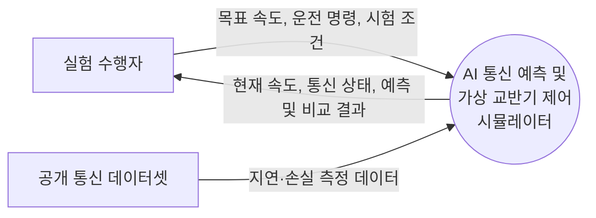

# 과제 1: 프로젝트 관리

## AI 기반 통신 상태 예측 및 가상 교반기 제어 시뮬레이터

| 항목 | 내용 |
| --- | --- |
| 과목 | 소프트웨어공학 |
| 이름 | 박민준 |
| 학번 | 22211988 |

## 프로젝트 개요

본 프로젝트는 연구실에서 원격으로 교반기를 조작하는 상황을 노트북에서 시뮬레이션한다.

프로그램은 가상의 통신 지연과 메시지 누락을 재현한다. AI 모델은 최근 통신 상태를 바탕으로 다음 구간의 통신 품질을 예측하고, 제어기는 예측 결과와 실제 명령 수신 상태에 따라 가상 교반기의 운전·감속·정지를 결정한다.

프로젝트의 목적은 통신 장애를 없애는 것이 아니라, **통신 상태가 나빠질 때 제어 대상이 정해진 방식으로 대응하도록 설계하고 그 결과를 비교하는 것**이다.

> 사용 상황과 개발 일정은 과제를 위한 계획 가정이다. 실제 연구실의 요구사항이나 장비 성능을 확인한 결과는 아니다.

## 1단계: 대상 제어기 선택

### 1.1 대상 제어기

대상 제어기는 **가상 교반기의 속도 및 운전 상태를 제어하는 소프트웨어 제어기**이다.

사용자는 화면에서 교반기의 목표 회전속도를 설정하고 시작·정지 명령을 입력한다. 제어기는 통신 상태와 AI 예측 결과를 확인한 뒤 가상 교반기의 운전 상태를 결정한다.

가상 교반기는 실제 모터가 아니라 프로그램 안에 구현한 모델이다. 목표 속도, 현재 속도, 운전 상태를 값으로 관리하며, 별도의 센서·카메라·임베디드 장비 없이 노트북에서 실행한다.

### 1.2 입력·처리·출력

| 구분 | 내용 |
| --- | --- |
| 입력 | 목표 속도, 시작·정지 명령, 통신 지연·누락 정보 |
| 처리 | 통신 상태 예측, 운전 정책 판단, 가상 속도 계산 |
| 출력 | 현재 속도, 운전 상태, 통신 상태, 예측 및 시험 결과 |

### 1.3 선정 이유

- 연구실 장비의 원격 제어라는 사용 상황을 구체적으로 설정할 수 있다.
- 통신 상태 예측과 제어기 대응을 하나의 시스템으로 연결할 수 있다.
- 노트북에서 가상 장치와 통신 장애를 재현하므로 1인이 구현하기 적합하다.
- 동일한 조건에서 규칙 기반 제어와 AI 보조 제어를 비교할 수 있다.

## 2단계: 프로젝트 범위 정의

### 2.1 프로젝트 목표

1. 사용자가 가상 교반기의 목표 속도를 설정하고 운전을 시작·정지할 수 있도록 한다.
2. 가상 통신 환경에서 메시지 지연과 누락을 재현한다.
3. 최근 통신 측정값을 이용해 다음 구간의 통신 상태를 예측한다.
4. 통신 상태에 따라 교반기의 정상 운전·감속·정지를 제어한다.
5. 규칙 기반 방식과 AI 보조 방식의 결과를 동일한 조건에서 비교한다.

### 2.2 범위 포함 사항: In-Scope

| ID | 기능 | 설명 |
| --- | --- | --- |
| F-01 | 사용자 조작 | 시작·정지와 목표 속도 설정 |
| F-02 | 가상 교반기 | 현재 속도와 운전 상태를 계산 |
| F-03 | 가상 통신 환경 | 명령 전달 지연과 메시지 누락 재현 |
| F-04 | AI 통신 상태 예측 | 최근 통신 정보를 바탕으로 다음 구간의 상태 예측 |
| F-05 | 운전 상태 제어 | 통신 조건에 따른 정상 운전·감속·정지 |
| F-06 | 결과 표시 및 저장 | 통신 상태, 예측 결과, 속도 변화와 비교 결과 표시 |

### 2.3 범위 제외 사항: Out-of-Scope

- 실제 교반기, 모터, 센서와의 연결
- 실제 연구용 장비의 제어 성능이나 안전성 검증
- 여러 장치를 동시에 제어하는 기능
- 인터넷을 통한 원격 서비스 배포
- 실제 네트워크에 장애를 주입하는 기능
- 대규모 언어모델의 직접 학습

### 2.4 제어 정책

- **정상 운전:** 통신 상태가 양호하면 설정한 목표 속도로 운전한다.
- **사전 감속:** AI가 다음 구간의 통신 품질 저하 가능성을 높게 예측하면 감속할 수 있다.
- **통신 공백 대응:** 일정 시간 유효한 운전 명령이 도착하지 않으면 AI 예측과 관계없이 정지한다.
- **예측 사용 불가:** AI 모델이 실패하거나 사용할 수 없으면 규칙 기반 정책으로 대응한다.
- **재시작:** 통신 상태가 회복된 후 사용자의 명시적인 시작 명령을 받아 운전한다.

AI의 예측이 항상 정확하다고 가정하지 않는다. 잘못된 예측으로 발생하는 불필요한 감속도 평가한다.

### 2.5 주요 산출물 및 완료 기준

| 산출물 | 완료 기준 |
| --- | --- |
| 요구사항 및 설계 문서 | 범위, 시스템 경계, 기능과 상태 전이가 정리되어 있다. |
| 시뮬레이터 | 목표 속도 설정과 정상·지연·누락 상황을 실행할 수 있다. |
| AI 예측 모델 | 분리된 시험 데이터에서 예측 결과를 확인할 수 있다. |
| 시험 결과 | 두 제어 방식의 결과와 비교 조건이 기록되어 있다. |
| 사용 안내서 | 실행 방법과 주요 기능, 시뮬레이션의 한계가 설명되어 있다. |

## 3단계: 시스템 문맥도 및 이해관계자 분석

### 3.1 시스템 경계

대상 시스템은 **AI 통신 예측 및 가상 교반기 제어 시뮬레이터**이다.

시뮬레이터 내부에는 사용자 화면, 가상 통신 환경, AI 예측 모델, 제어기, 가상 교반기가 포함된다. 사용자와 공개 통신 데이터셋은 시스템 외부 요소로 정의한다.

### 3.2 이해관계자 분석

| 이해관계자 | 역할 | 주요 요구사항 |
| --- | --- | --- |
| 실험 수행자 | 시뮬레이션을 실행하고 결과를 확인한다. | 목표 속도 설정, 상태 확인, 결과 비교 |
| 연구실 장비 관리자 | 가상 장비의 운전 정책을 검토한다. | 장애 시 감속·정지 조건의 명확성 |
| 개발자 | 시뮬레이터와 AI 모델을 구현한다. | 구현 가능한 범위와 시험 기준 |
| 교수자 | 과제의 범위와 산출물을 평가한다. | 요구사항 분석, 규모 산정, WBS의 일관성 |

실험 수행자와 장비 관리자는 실제 인터뷰를 수행한 대상이 아니라, 프로젝트 분석을 위해 설정한 가상 이해관계자이다.

## 4단계: 제약사항 조사

| 구분 | 제약사항 및 대응 |
| --- | --- |
| 개발 인력 | 1인 개발을 가정하고 장치 1대와 화면 1개로 범위를 제한한다. |
| 개발 환경 | 노트북에서 로컬 실행한다. 필요한 라이브러리와 데이터를 확보한 뒤 오프라인 실행을 목표로 한다. |
| 데이터 | 공개 데이터는 실제 교반기 명령 기록이 아니므로 통신 상태 재현에 활용한다. |
| 측정 간격 | 데이터가 약 30초 간격이므로 초 단위 통신 장애 예측 성능을 입증할 수 없다. |
| 통신 모델 | 공개 데이터의 왕복 지연과 개별 명령 전달 시간은 다르므로 메시지 전달은 별도 규칙으로 모의한다. |
| AI 모델 | 예측 오류와 오경보가 발생할 수 있으므로 규칙 기반 정지 조건을 유지한다. |
| 검증 범위 | 가상 환경에서의 결과이며 실제 장비나 실제 네트워크의 성능으로 일반화하지 않는다. |

### 4.1 데이터 활용 계획

[LocalNetDynamics](https://huggingface.co/datasets/ezharjan/LocalNetDynamics)의 지연·손실 측정값을 활용한다. 이 자료는 약 30초 간격의 통신 측정값과 규칙 기반 참고 라벨을 포함한다.

- 최근 측정값을 입력으로 사용해 **다음 30초 구간의 통신 품질**을 예측한다.
- 과거 구간을 학습에, 이후 구간을 시험에 사용해 미래 정보의 누출을 피한다.
- 데이터의 이상 라벨은 참고값이며, 모든 실제 장애를 독립적으로 확인한 정답으로 간주하지 않는다.
- 데이터는 한 장소의 측정 결과이므로 다른 환경에 대한 일반화에는 한계가 있다.

## 5단계: 프로젝트 규모 산정

### 5.1 개발 규모

| 항목 | 계획 규모 |
| --- | --- |
| 필수 기능 | 6개 |
| 사용자 화면 | 1개 |
| 데이터셋 | 1종 |
| 가상 제어 대상 | 교반기 1대 |
| 통신 장애 유형 | 지연, 메시지 누락 |
| 운전 상태 | 정상 운전, 감속, 정지 |
| 제어 방식 | 규칙 기반 방식, AI 보조 방식 |

### 5.2 공수 및 기간

공수는 각 작업에 필요한 사람의 투입 시간이다. 다음은 실제 일정이 확정되기 전의 **초기 계획 가정**이다.

- 개발 인력: **1명**
- 개발 기간: **6주**
- 주당 가용 시간: **8시간**
- 전체 가용 공수: **48시간**
- WBS 기본 공수: **42시간**
- 예비 공수: **6시간**

작업별 기본 공수는 다음 WBS의 예상 시간을 합산했다. 예비 공수는 예상하지 못한 데이터 처리, 오류 수정, 재시험에 사용한다.

주차별 기본 작업과 예비 시간을 합쳐 주당 8시간을 넘지 않도록, 예비 시간은 **1주차 3시간, 2주차 1시간, 5주차 2시간**으로 배정한다. 실제 참여 시간이나 작업 난이도가 다르면 공수와 일정을 다시 산정한다.

## 6단계: 주요 업무 구분 및 WBS 연계

WBS(Work Breakdown Structure)는 프로젝트 업무를 관리 가능한 작업 단위로 나눈 구조이다.

| WBS | 주요 업무 | 산출물 | 관련 기능 | 예상 공수 | 계획 시점 |
| --- | --- | --- | --- | ---: | --- |
| 1.0 | 요구사항 및 범위 정의 | 기능 목록, 사용 시나리오 | F-01~F-06 | 5시간 | 1주차 |
| 2.0 | 데이터 조사 및 전처리 | 학습·시험 데이터 | F-04 | 7시간 | 2주차 |
| 3.0 | 가상 장치 및 통신 구현 | 속도·지연·누락 모델 | F-02, F-03 | 8시간 | 3주차 |
| 4.0 | AI 예측 모델 구현 | 학습 모델, 예측 결과 | F-04 | 8시간 | 4주차 |
| 5.0 | 제어 정책 및 화면 구현 | 운전 상태 제어, 사용자 화면 | F-01, F-05, F-06 | 6시간 | 5주차 |
| 6.0 | 통합 시험 및 보고서 작성 | 비교 결과, 사용 설명 | F-01~F-06 | 8시간 | 6주차 |
| **합계** | **기본 공수** |  |  | **42시간** | **6주** |

### 6.1 작업 간 선행 관계

1. 요구사항과 구현 범위를 정의한다.
2. 공개 데이터의 항목과 측정 간격을 확인하고 학습·시험용으로 나눈다.
3. 가상 교반기와 통신 환경을 구현한다.
4. 통신 상태 예측 모델을 만들고 시험한다.
5. 가상 환경과 AI 예측 결과를 제어기 및 화면에 연결한다.
6. 동일한 시나리오에서 제어 방식을 비교하고 결과를 문서화한다.

### 6.2 시험 및 평가 계획

동일한 가상 통신 시나리오에서 다음 두 방식을 비교한다.

| 비교 방식 | 동작 |
| --- | --- |
| 규칙 기반 제어 | 통신 공백 기준에 도달하면 감속 또는 정지한다. |
| AI 보조 제어 | 품질 저하 가능성이 높으면 사전 감속하고, 공백 기준에 도달하면 정지한다. |

평가 지표는 다음과 같다.

- 다음 구간 통신 상태의 예측 정확도 및 오경보
- 불필요하게 감속한 횟수
- 장애 상황에서 가상 교반기가 계속 운전한 시간
- 통신 공백 발생 후 정지까지의 시간

측정 간격과 가상 메시지 전달 규칙을 함께 기록한다. AI가 항상 더 좋은 결과를 낸다고 가정하지 않고, 비교 결과와 한계를 함께 제시한다.

## 참고자료

1. [LocalNetDynamics — 공개 통신 측정 데이터](https://huggingface.co/datasets/ezharjan/LocalNetDynamics)
2. [scikit-learn — 시계열 예측과 시간순 평가 예제](https://scikit-learn.org/stable/auto_examples/applications/plot_time_series_lagged_features.html)
3. [RIPE Atlas — 네트워크 측정 자료](https://atlas.ripe.net/docs/apis/rest-api-reference/measurements)
